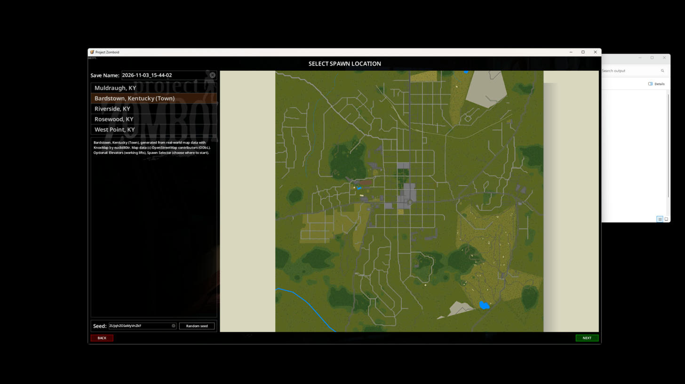
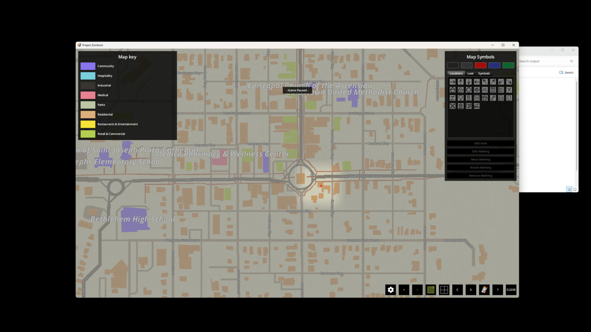
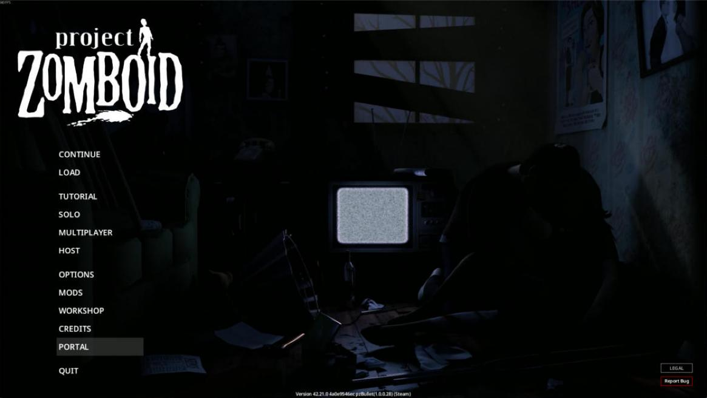
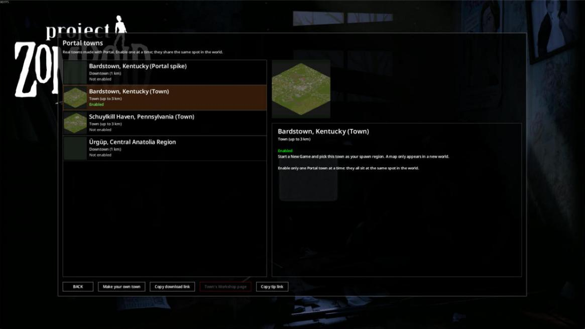
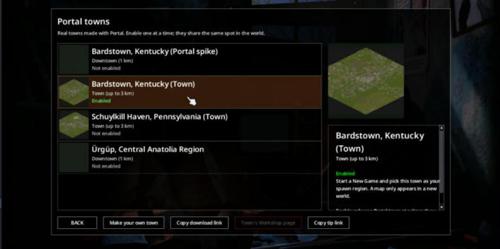

# First runs — 2026-11-03

KnoxMap 1.8.4, Project Zomboid 42.21.0 (Steam build 25485521), Dean's PC.

| Run | How | Cells | Time | Result |
|---|---|---|---|---|
| Bardstown, Kentucky — downtown | spike driver | 25 | 3.2 min | installed, 31 MB; 854 buildings, 113 named streets, 8 spawn points |
| Ürgüp, Central Anatolia Region — downtown | Portal UI, browser | 25 | 11.5 min (9 min OSM download) | installed, 26 MB; Workshop folder prepared |
| Bardstown, Kentucky — town | Portal.exe API | 169 | 16.3 min | installed, 185 MB; played in-game, see below |

## In-game playtest: Bardstown, Kentucky (Town)

Solo, "Rising" preset, default character. The game ran windowed for the test
(`Zomboid/options.ini` borderless=false, restored afterwards) and later with
`-debug` so a Lua console could teleport, scan containers and reveal the map.

### Checked

- **Mods menu:** the mod is listed and enables (id `portal_bardstown_kentucky_town`).
  
- **New Game:** "Bardstown, Kentucky" is offered as a spawn region next to the
  vanilla towns, and the game starts there.
- **Streets and buildings:** downtown (cell 88_5, around 22656,1408) has a
  two-lane street with lane markings, sidewalks, grass verges, a street light,
  a fire hydrant and shop fronts with doors.
  
  
- **Loot matches the shop:** a Lua scan of the 300×300 tiles around downtown
  found 2,107 containers; loot had already spawned in the game's own way (none
  needed filling). Samples:
  - grocery fridges: cheese, milk, lard, margarine
  - pharmacy: pills in the display case, medical and relationship paperbacks
  - clothing store: shoes, work boots, sports T-shirts and shorts
  - convenience store fridges: water, burritos, juice boxes, croissants
  - general store: bowls, cutlery, whetstones; candy; yoghurt
  - garden store: seed packets, farming books, gravel bags
  - bookstore: knitting, tailoring, welding and mechanics books
  - bank: paperwork and letters in filing cabinets
  - restaurant kitchen: plates, bowls, mugs, oven mitts

  Around the spawn house (residential), 191 of 209 containers had loot.
- **World map:** works, in both isometric and top-down views, with real
  street names (West Flaget Street, North 3rd Street, West Broadway, Mulberry
  Alley, Blackberry Alley, Raspberry Alley) and labelled landmarks (Women's
  Civil War Museum, Episcopal Church of the Ascension, Bardstown United
  Methodist Church, Medica Pharmacy & Wellness Center, Proto-Cathedral School).
  
- **Town outline:** the `town` preset did clip to Bardstown's city limits.
  The outline KnoxMap was given covers 86% of the 3 km square, and only 8 of
  2,549 buildings fall outside it. Bardstown's limits fill most of that square,
  so the revealed map still looks square, with roads running to its edges.
  
- Dedicated server (`-nosteam`, `Zomboid/Server/portaltest.ini`) booted with the
  Bardstown downtown mod: `SERVER STARTED`, no SEVERE lines or exceptions.

### Broken or rough

- **Fixed in Portal:** every size of one place had the same name, e.g. Downtown
  and Town were both "Bardstown, Kentucky". KnoxMap uses that name for the mod
  and for its map folder, so the two would share one map folder if both were
  enabled. Portal now names them "Bardstown, Kentucky (Town)" and so on. The
  towns already installed keep their old names until they are made again.
- **KnoxMap side, not fixed:**
  - The spawn screen shows a blank map for the town.
  - The Mods list shows no poster image.
  - The first spawn was a dark, unlit house at the north edge of the map
    (spawn point 22567,131), not downtown. It is one of 8 spawn points KnoxMap
    picks.
- Zombies were waiting on the downtown street right away, which is normal for
  the game.

## In-game playtest: Schuylkill Haven, Pennsylvania (Town)

Tests the poster, spawn-map and address-spawn changes ("feat: poster, spawn
picture, central spawns and spawn-at-address" and the two commits after it).
The mod was made with fill_gaps (2,421 buildings) and has one spawn point,
at the address Dean chose. Solo, "Rising", game started with `-debug` and
windowed; Bardstown turned off so the two maps could not overlap. The address
is not written here. The street and world-map screenshots from this run were
removed because they could show where the spawn house is.

1. **Poster and map icon: pass.** The Mods list shows a map icon next to
   "Schuylkill Haven, Pennsylvania (Town)" and the poster (the town render)
   in the details panel.
   
2. **Spawn-screen picture: fail.** The panel is no longer blank, but it shows
   the wrong picture: the top-left corner of the vanilla Knox County spawn
   map (its "Come and visit our esteemed partners" advert board, with the
   P.S. Delilah, McCoy Logging and Scarlet Oak Distillery). Zooming out shows
   only more of the vanilla artwork, never the town. Double-clicking the region
   acts as Next and opens the occupation page; going Back shows the same
   vanilla art again. Likely cause: the spawn screen draws every map's picture
   in one shared space. Moving the town's pyramid bounds to 0,0 (and zoomX/zoomY
   to 1350,1500) puts it underneath the vanilla map's picture, which is drawn
   instead. The town's picture probably needs bounds at its real world
   position (cells 82–94 × 0–12), with zoomX/zoomY on the town.
   
3. **Address spawn: pass.** A new game started exactly on the chosen spawn
   point, standing in the doorway of a lit, furnished bathroom (sink, toilet,
   bathtub, rug). The debug console reported room=bathroom inside a building
   with a kitchen, living room, two bedrooms and a bathroom; the square is free
   and not solid, so the character was not in a wall. The world map put the
   house on the right street. Not a dark house, empty lot or map edge.
   
4. **Streets, buildings, world map: pass.** Residential streets with sidewalks,
   front paths, mailboxes, parked cars and brick or sided houses with pitched
   roofs. The world map shows the Schuylkill River and real street names
   (East Main Street, West Main Street, Saint John Street, Jackson Street,
   Daisy Alley) and labelled places (Island Park, Green Goose Playground).

### Recheck: spawn-screen picture after the fix

After "fix: show the town's spawn picture beside vanilla Knox County's", which
moves the pyramid back to the town's real world tiles, adds zoomX/zoomY on the
town, and adds the `..._SpawnPicture.lua` client patch. Game restarted, without
`-debug`.

1. **No Lua errors from the patch: pass.** `console.txt` shows the mod loading
   and contains no line mentioning SpawnPicture. The only Lua error is
   vanilla's (a Muldraugh mannequin zone). The other errors are vanilla Knox
   County cells, fonts and fluid containers.
2. **Town picture: pass.** With Schuylkill Haven selected, the panel shows the
   town's own picture: the Schuylkill River, the street grid and the
   downtown blocks. Zooming out shows the vanilla Knox County artwork on the
   left (its right edge, with the restaurant visitor-map legend), a cream gap,
   then the town on the right. The frame's cream background reaches below
   the town picture's bottom edge, which is only cosmetic.
   
   
3. **Switching regions: pass.** Selecting Muldraugh moves the view to the
   vanilla Muldraugh map with its description and picture. Selecting
   Schuylkill Haven again moves it back to the town.

## Showcase check: Bardstown, Kentucky (Town), before the Workshop upload

This is the regenerated mod, titled "Bardstown, Kentucky (Town)" with map folder
"Bardstown, Kentucky Town". Schuylkill Haven was turned off. The game loaded the
mod from the prepared Workshop folder (`Zomboid/Workshop/.../Contents/mods/...`,
Source: Workshop). That copy is byte-identical to the one in `Zomboid/mods`
(529 files, no differences), so this run tested exactly what gets uploaded.
Solo, "Rising", run with `-debug`.

1. **Mods list: pass.** Map icon and poster both show.
2. **Spawn screen: pass.** Bardstown's own picture, with the street grid,
   downtown and woods. Selecting Muldraugh moves to the vanilla map, and
   selecting Bardstown moves back.
   
3. **Spawns: pass, with one dark house.** Three new games:
   - Games 1 and 2: 22708,1681, a bedroom in a large apartment-style building
     just southeast of Court Square. Free square, light 0.90 at 9 am, power on,
     so it is lit.
   - Game 3: 22691,1712, a hallway in a 29-room building. Free square, but
     light 0.07, so it is dark.

   All three were downtown, inside a home, and away from the map edge. None
   was in a wall.
4. **Streets and world map: pass.** The map around the spawn shows Court
   Square, West and East Stephen Foster Avenue, Flaget Street, John Fitch
   Avenue, Bethlehem High School, Medica Pharmacy & Wellness Center, and the
   Episcopal and United Methodist churches.
   
5. **Console: pass.** No line mentions SpawnPicture. The only Lua errors are
   vanilla's Muldraugh mannequin zone.

## Companion mod check: "Portal" (portal_companion, 64c55c5)

Game started through Steam, windowed, no `-debug`. The Mods screen showed the
mod loading from the prepared Workshop folder
(`Zomboid/Workshop/portal_companion/...`, Source: Workshop). That copy matches
`Zomboid/mods/portal_companion` file for file (7 files, same hashes).
Bardstown (Town) stayed enabled. No controller tested.

1. **Mods list: pass.** "Portal" has a map icon, and the details panel shows
   the poster (dark map, PORTAL, "real towns for Project Zomboid") and the
   description.
2. **Main menu entry: pass.** After Accept, PORTAL sits right after CREDITS
   with QUIT below it, in the same font and spacing. On hover it gets the same
   grey bar as the vanilla entries, with the same width. Nothing overlaps or is
   cut off. QUIT still opens "Quit to desktop?" and Yes closes the game.
   
3. **Panel: pass.** The panel is titled "Portal towns" and has the one-line
   intro. The list shows Bardstown, Kentucky (Portal spike), Bardstown,
   Kentucky (Town), Schuylkill Haven, Pennsylvania (Town) and Ürgüp, Central
   Anatolia Region. Each has a size and Enabled or Not enabled (only Bardstown
   (Town) is Enabled). Portal itself is not listed. The two Town mods have
   poster thumbnails. The spike and Ürgüp have none, because they were made
   before posters, so they show a dark square. With nothing selected, the right
   side shows the three steps, the GitHub releases URL, the one-at-a-time
   note, the credits and the tip URL.
4. **Selected town: pass.** Selecting Bardstown (Town) shows its poster at the
   top of the right column, then its name, "Town (up to 3 km)", Enabled and
   how to play. The text starts at the top of its box.
   
5. **Buttons: pass.**
   - "Copy download link" opens a dialog reading "Link copied. Paste it into
     your browser:", with the URL on the next line. There is no literal `\n` or
     ` `. The block is centred in the dialog; the two lines share a left
     edge. OK closes it. The clipboard held
     `https://github.com/derpasaurus69-crypto/zomboidmods/releases`.
   - "Copy tip link" behaves the same, and the clipboard held
     `https://buymeacoffee.com/derpasauruo`.
   - "Make your own town" copied the download link and showed the same dialog,
     since the companion has no Workshop ID yet.
   - "Town's Workshop page" stays greyed out with nothing selected and with
     Bardstown selected. Clicking it does nothing. The Bardstown copy the
     game loads is the local Workshop folder, which has no Workshop ID.
6. **Back and Esc: pass.** BACK closes the panel and the main menu returns.
   Reopening it shows the guide again with nothing selected, and Esc closes
   it. With the copy dialog open, Esc closes neither the dialog nor the panel;
   OK is the way out.
7. **Window size: pass, with a cramped detail column.** Maximising the window
   and then shrinking it to 1280×760 keeps the panel centred at 80% of the
   window, fully on screen, and the buttons fit. The town list keeps the width
   it had when the panel opened, though, so in the small window the right
   column is narrow. The town name wraps, the text needs its scrollbar, and
   one line runs up against the scrollbar.
   
8. **Console: pass.** `console.txt` shows `loading portal_companion` and no
   Lua errors at all; nothing mentions PortalCompanion. The other errors are
   vanilla fonts and fluid containers. One line to know about:
   `mod "portal_companion" overrides media/lua/shared/translate/en/ui.json`.
   Vanilla strings still showed (BACK, Ok, the menu), so the game merged the
   two files rather than replacing vanilla's, but a file name that doesn't
   match vanilla's would avoid the question.

Cosmetic: the panel is 80% opaque, so the game's logo shows faintly behind
the "Portal towns" title, and its top edge pokes out above the panel. The copy
dialog is also see-through, so the town text shows behind it.

## Not checked yet

- Multiplayer.
- Ürgüp, the Downtown and City core presets in the client (Bardstown and
  Schuylkill Haven were played, both at the Town size).
- Updating an item already on the Workshop (Publish again with its id).

## Bugs found and fixed on the way

- Postcodes ("50400") were taken as the region in IDs and titles.
- Previews and engine logs were left in the staging folder.
- A damaged preview image crashed Publish.
- Each size of one place had the same mod name and map folder (found in-game).
- No poster, a blank spawn-screen picture and spawns at the map edge (found
  in-game, fixed and rechecked in-game).
- A thinly mapped town (Schuylkill Haven, 157 buildings) left the chosen
  address on an empty lot; fixed with the gap-filling option.
