# First runs — 2026-11-03

KnoxMap 1.8.4, Project Zomboid 42.21.0 (Steam build 25485521), Dean's PC.

| Run | How | Cells | Time | Result |
|---|---|---|---|---|
| Bardstown, Kentucky — downtown | spike driver | 25 | 3.2 min | installed, 31 MB; 854 buildings, 113 named streets, 8 spawn points |
| Ürgüp, Central Anatolia Region — downtown | Portal UI, browser | 25 | 11.5 min (9 min OSM download) | installed, 26 MB; Workshop folder prepared |
| Bardstown, Kentucky — town | Portal.exe API | 169 | 16.3 min | installed, 185 MB; played in-game, see below |

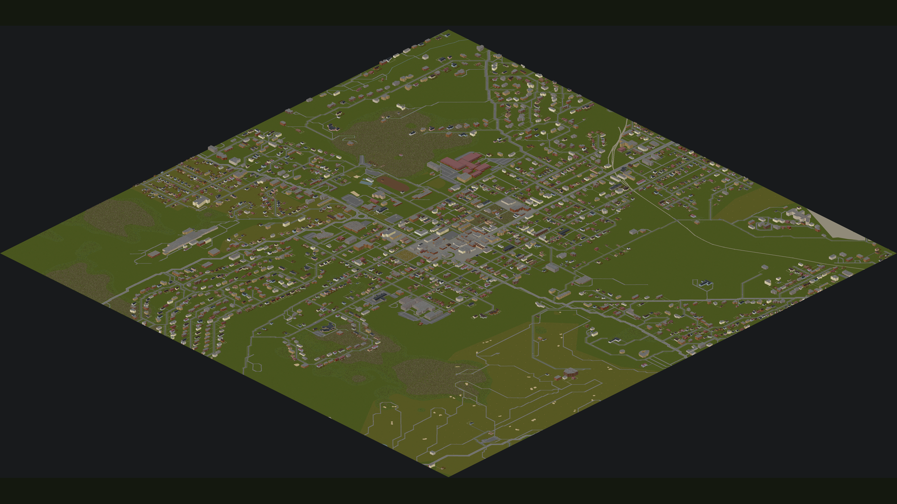

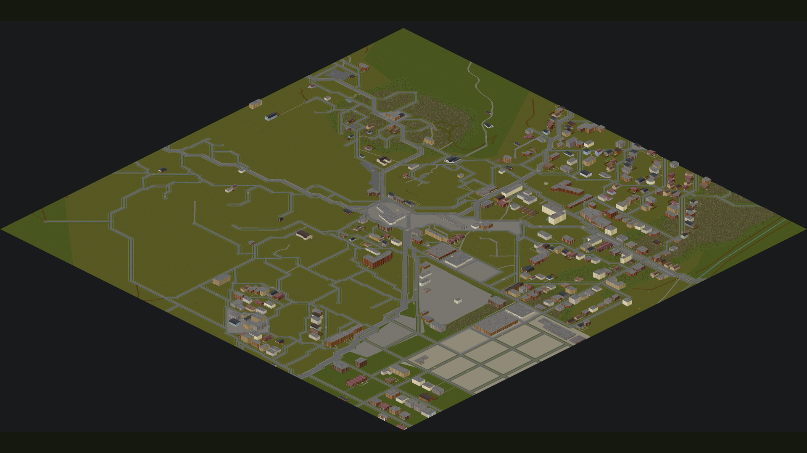

## In-game playtest: Bardstown, Kentucky (Town)

Solo, "Rising" preset, default character. The game ran windowed for the test
(`Zomboid/options.ini` borderless=false, restored afterwards) and later with
`-debug` so a Lua console could teleport, scan containers and reveal the map.

### Checked

- **Mods menu:** the mod is listed and enables (id `portal_bardstown_kentucky_town`).
  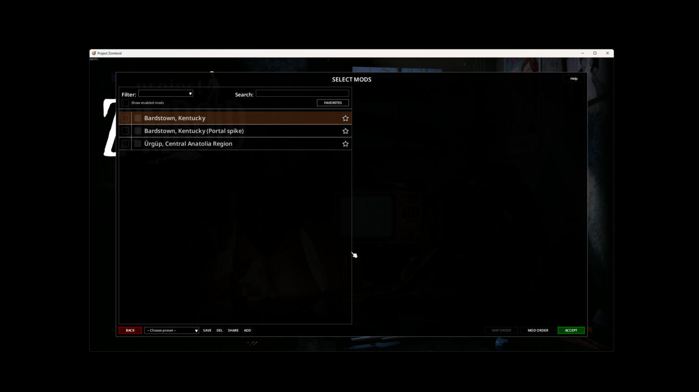
- **New Game:** "Bardstown, Kentucky" is offered as a spawn region next to the
  vanilla towns, and the game starts there.
- **Streets and buildings:** downtown (cell 88_5, around 22656,1408) has a
  two-lane street with lane markings, sidewalks, grass verges, a street light,
  a fire hydrant and shop fronts with doors.
  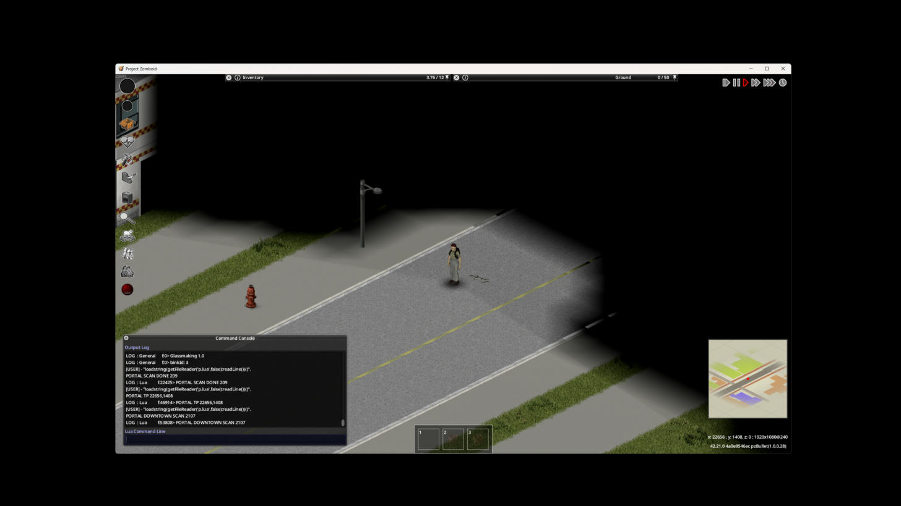
  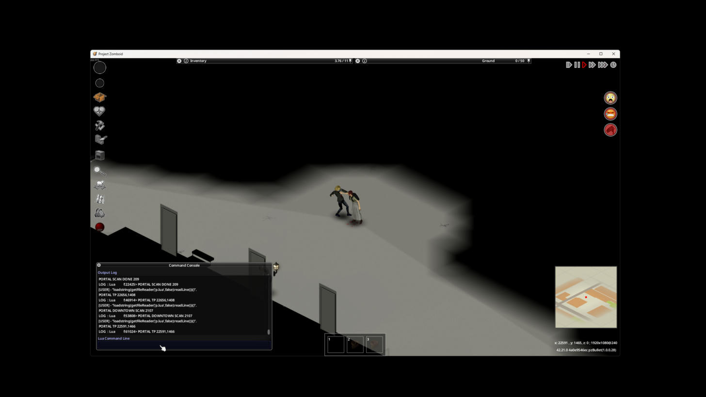
- **Loot matches the shop:** a Lua scan of the 300×300 tiles around downtown
  found 2,107 containers; loot had already spawned in the game's own way (none
  needed filling). Samples:
  - grocery fridges: cheese, milk, lard, margarine
  - pharmacy: pills in the display case, medical and relationship paperbacks
  - clothing store: shoes, work boots, sports T-shirts and shorts
  - convenience store fridges: water, burritos, juice boxes, croissants
  - general store: bowls, cutlery, whetstones; candy; yoghurt
  - garden store: seed packets, farming books, gravel bags
  - bookstore: knitting, tailoring, welding and mechanics books
  - bank: paperwork and letters in filing cabinets
  - restaurant kitchen: plates, bowls, mugs, oven mitts

  Around the spawn house (residential), 191 of 209 containers had loot.
- **World map:** works, in both isometric and top-down views, with real
  street names (West Flaget Street, North 3rd Street, West Broadway, Mulberry
  Alley, Blackberry Alley, Raspberry Alley) and labelled landmarks (Women's
  Civil War Museum, Episcopal Church of the Ascension, Bardstown United
  Methodist Church, Medica Pharmacy & Wellness Center, Proto-Cathedral School).
  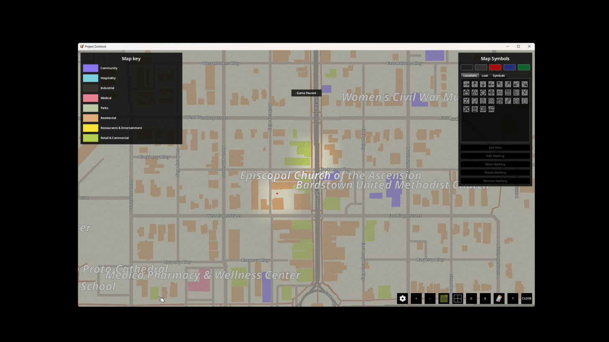
- **Town outline:** the `town` preset did clip to Bardstown's city limits.
  The outline KnoxMap was given covers 86% of the 3 km square, and only 8 of
  2,549 buildings fall outside it. Bardstown's limits fill most of that square,
  so the revealed map still looks square, with roads running to its edges.
  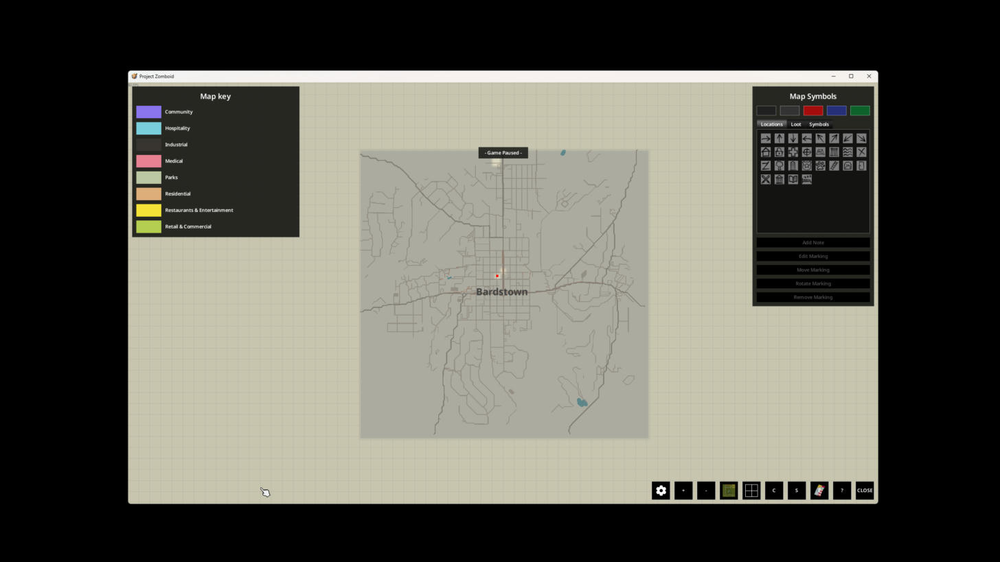
- Dedicated server (`-nosteam`, `Zomboid/Server/portaltest.ini`) booted with the
  Bardstown downtown mod: `SERVER STARTED`, no SEVERE lines or exceptions.

### Broken or rough

- **Fixed in Portal:** every size of one place had the same name, e.g. Downtown
  and Town were both "Bardstown, Kentucky". KnoxMap uses that name for the mod
  and for its map folder, so the two would share one map folder if both were
  enabled. Portal now names them "Bardstown, Kentucky (Town)" and so on. The
  towns already installed keep their old names until they are made again.
- **KnoxMap side, not fixed:**
  - The spawn screen shows a blank map for the town.
  - The Mods list shows no poster image.
  - The first spawn was a dark, unlit house at the north edge of the map
    (spawn point 22567,131), not downtown. It is one of 8 spawn points KnoxMap
    picks.
- Zombies were waiting on the downtown street right away, which is normal for
  the game.

## In-game playtest: Schuylkill Haven, Pennsylvania (Town)

Tests the poster, spawn-map and address-spawn changes (commits 9806d9b,
eaa016e, 595d97c). The mod was made with fill_gaps (2,421 buildings) and has
one spawn point, at the address Dean chose. Solo, "Rising", game started
with `-debug` and windowed; Bardstown turned off so the two maps could not
overlap. The address is not written here, and no screenshot here shows the
spawn house's position.

1. **Poster and map icon: pass.** The Mods list shows a map icon next to
   "Schuylkill Haven, Pennsylvania (Town)" and the poster (the town render)
   in the details panel.
   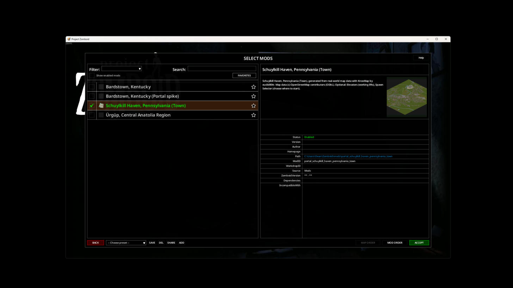
2. **Spawn-screen picture: fail.** The panel is no longer blank, but it shows
   the wrong picture: the top-left corner of the vanilla Knox County spawn
   map (its "Come and visit our esteemed partners" advert board, with the
   P.S. Delilah, McCoy Logging and Scarlet Oak Distillery). Zooming out shows
   only more of the vanilla artwork, never the town. Double-clicking the region
   acts as Next and opens the occupation page; going Back shows the same
   vanilla art again. Likely cause: the spawn screen draws every map's picture
   in one shared space. Moving the town's pyramid bounds to 0,0 (and zoomX/zoomY
   to 1350,1500) puts it underneath the vanilla map's picture, which is drawn
   instead. The town's picture probably needs bounds at its real world
   position (cells 82–94 × 0–12), with zoomX/zoomY on the town.
   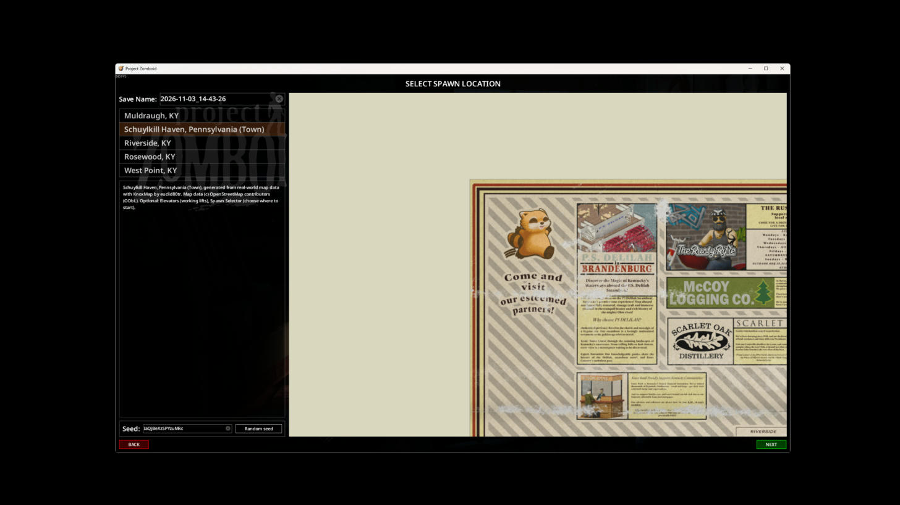
3. **Address spawn: pass.** A new game started exactly on the chosen spawn
   point, standing in the doorway of a lit, furnished bathroom (sink, toilet,
   bathtub, rug). The debug console reported room=bathroom inside a building
   with a kitchen, living room, two bedrooms and a bathroom; the square is free
   and not solid, so the character was not in a wall. The world map puts the
   house on the street of the address Dean chose. Not a dark house, empty lot or
   map edge.
   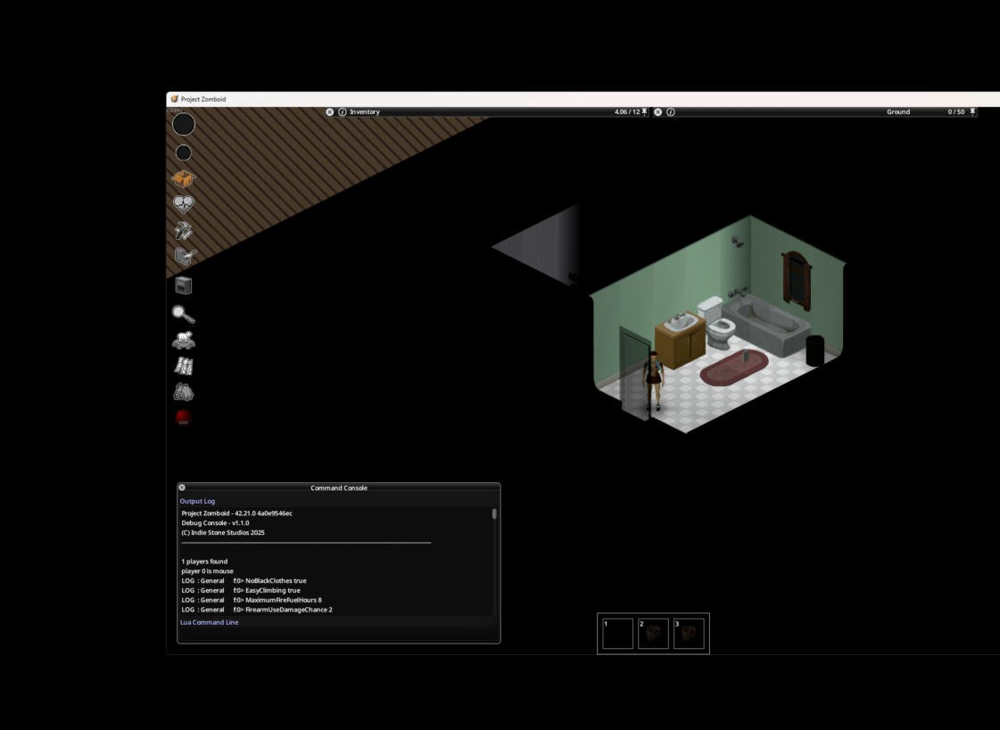
4. **Streets, buildings, world map: pass.** Residential streets with sidewalks,
   front paths, mailboxes, parked cars and brick or sided houses with pitched
   roofs. The world map shows the Schuylkill River and real street names
   (East Main Street, West Main Street, Saint John Street, Jackson Street,
   Daisy Alley) and labelled places (Island Park, Green Goose Playground).
   
   

### Recheck: spawn-screen picture after the fix

After "fix: show the town's spawn picture beside vanilla Knox County's", which
moves the pyramid back to the town's real world tiles, adds zoomX/zoomY on the
town, and adds the `..._SpawnPicture.lua` client patch. Game restarted, without
`-debug`.

1. **No Lua errors from the patch: pass.** `console.txt` shows the mod loading
   and contains no line mentioning SpawnPicture. The only Lua error is
   vanilla's (a Muldraugh mannequin zone). The other errors are vanilla Knox
   County cells, fonts and fluid containers.
2. **Town picture: pass.** With Schuylkill Haven selected, the panel shows the
   town's own picture: the Schuylkill River, the street grid and the
   downtown blocks. Zooming out shows the vanilla Knox County artwork on the
   left (its right edge, with the restaurant visitor-map legend), a cream gap,
   then the town on the right. The frame's cream background reaches below
   the town picture's bottom edge, which is only cosmetic.
   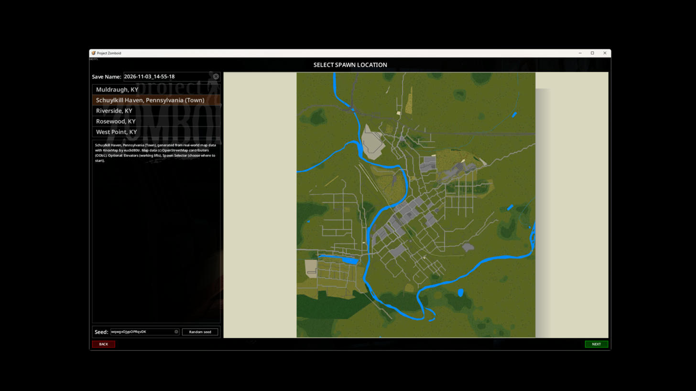
   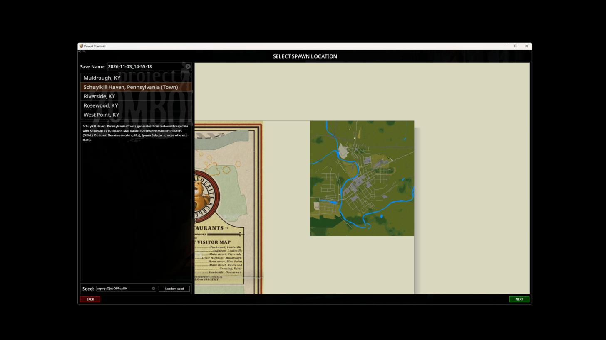
3. **Switching regions: pass.** Selecting Muldraugh moves the view to the
   vanilla Muldraugh map with its description and picture. Selecting
   Schuylkill Haven again moves it back to the town.

## Not checked yet

- Multiplayer.
- Ürgüp and the downtown preset in the client (only Bardstown Town was played).

## Bugs found and fixed on the way

- Postcodes ("50400") were taken as the region in IDs and titles.
- Previews and engine logs were left in the staging folder.
- A damaged preview image crashed Publish.
- Each size of one place had the same mod name and map folder (found in-game).
